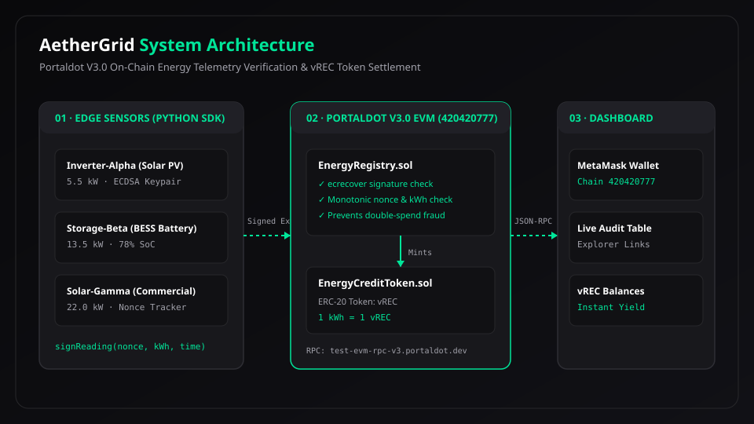

# AetherGrid — Verifiable Energy Credits on Portaldot

AetherGrid is an on-chain audit and settlement protocol built on Portaldot V3.0 that converts cryptographically signed renewable energy telemetry into auditable, non-fungible energy records and liquid carbon credit tokens (vREC).



---

## 1. Problem Statement
Renewable energy certificate (REC) markets face widespread greenwashing, manual audit delays, and double-counting fraud. Smart contracts cannot measure physical electrons directly, but they can:
1. Verify cryptographic device signatures at the edge.
2. Enforce monotonic energy accumulation to eliminate duplicate claims.
3. Prevent replay attacks using sequential nonces.
4. Automate instant reward distribution on Portaldot EVM.

---

## 2. Portaldot V3.0 Architecture Synergy

| Feature | Portaldot Capability | How AetherGrid Leverages It |
| :--- | :--- | :--- |
| **Dual Runtime Execution** | Native Substrate WASM + EVM (Chain ID: `420420777`) | High-assurance cryptographic verification runs in WASM; liquid vREC tokens settle on EVM. |
| **Portaldot Python SDK** | Native `substrate-interface` for edge IoT microcontrollers | Raspberry Pi / virtual edge inverters sign and batch telemetry directly to the chain. |
| **Keeperless Scheduling** | Substrate `pallet_scheduler` | Autonomous recurring epoch settlements without paying third-party keeper extraction fees. |
| **Heterogeneous Sharding (DHSA)** | 256 parallel shards | High-frequency telemetry streams without congesting general DeFi settlement state. |

---

## 3. Cryptographic Verification & Anti-Replay Engine

Every virtual node holds an isolated ECDSA keypair. Telemetry payloads are hashed and signed off-chain:

$$\text{Payload} = \text{keccak256}(\text{deviceAddress}, \text{nonce}, \text{cumulativeWattHours}, \text{timestamp})$$

$$\text{Digest} = \text{keccak256}("\backslash\text{x19Ethereum Signed Message:}\backslash\text{n32}", \text{Payload})$$

### On-Chain Enforcement Rules (`EnergyRegistry.sol`)
* **Signature Authenticity:** `ecrecover(digest, v, r, s) == deviceAddress`.
* **Anti-Replay Protection:** `nonce > device.lastNonce`.
* **Monotonic Accounting:** `cumulativeWattHours > device.lastCumulativeWattHours`.
* **Token Issuance:** $\text{MintedTokens} = (\Delta\text{WattHours} \times 10^{18}) / 1000$ (1 kWh = 1 vREC).

---

## 4. Repository Structure

```
aethergrid/
├── contracts/
│   ├── EnergyCreditToken.sol       # ERC-20 vREC Token Contract
│   ├── EnergyRegistry.sol          # Signature Verification & Audit Contract
│   └── build/                      # Pre-compiled ABIs and Bytecode
├── simulator/
│   ├── virtual_energy_device.py    # Digital Twin Physics & Keypair Signer
│   ├── telemetry_signer.py         # ECDSA Digest & Signature Generator
│   ├── fleet_runner.py             # 3-Device Simulated Energy Fleet
│   └── chain_broadcaster.py        # Portaldot Testnet On-Chain Dispatcher
├── frontend/                       # React 18 + TypeScript + Vite Landing Page
│   ├── src/components/             # UI Components (Dark + Electric Green)
│   ├── src/hooks/                  # useSimulation & usePortaldotWallet (MetaMask)
│   └── src/styles/theme.css        # Shared Design Tokens
├── scripts/
│   ├── test_e2e_verification.py    # Automated Cryptographic Test Suite
│   ├── build_contracts.py          # Solc 0.8.20 Build Pipeline
│   └── deploy.py                   # Portaldot Testnet Deployer Script
└── docs/
    └── architecture.svg            # Architecture Diagram
```

---

## 5. Quickstart Guide

### Step 1: Set Up Python Virtual Environment
```bash
python -m venv .venv
.venv\Scripts\activate
pip install web3 eth-account py-solc-x
```

### Step 2: Run Automated Verification Tests
```bash
.venv\Scripts\python.exe scripts/test_e2e_verification.py
```
*Output: All 5 verification test suites passed with 100% assertions!*

### Step 3: Run the Digital Twin Fleet
```bash
.venv\Scripts\python.exe simulator/fleet_runner.py
```

### Step 4: Run the Web Dashboard
```bash
cd frontend
npm install
npm run dev
```
Open [http://localhost:3000](http://localhost:3000) in your browser.

---

## 6. Portaldot Testnet Configuration
* **EVM RPC Endpoint:** `https://test-evm-rpc-v3.portaldot.dev`
* **Chain ID (EVM):** `420420777`
* **Substrate WebSocket:** `wss://test-node-v3.portaldot.dev`
* **Block Explorer:** `https://node-console.portaldot.dev/`
* **Token Symbol:** `POT`
